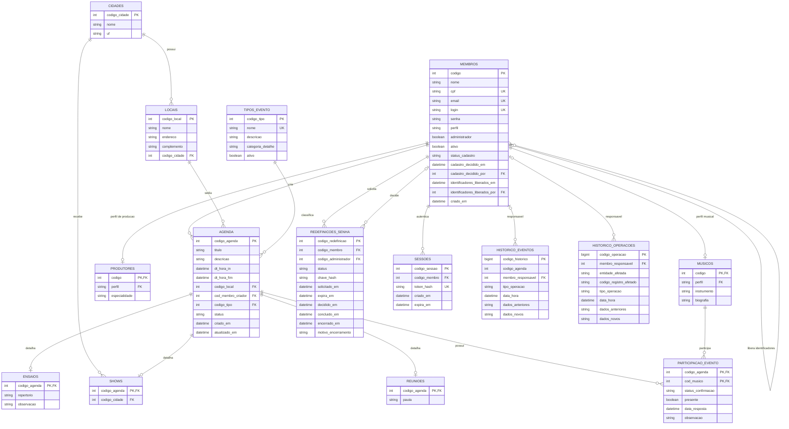

# Banco de dados e arquitetura

[Voltar ao README](README.md)

## Sumário

- [Arquitetura](#arquitetura)
- [Modelo de dados](#modelo-de-dados)
- [DER (Diagrama Entidade-Relacionamento)](#der)
- [Dicionário de dados](DICIONARIO_DE_DADOS.md)
- [Recursos SQL e auditoria](RECURSOS_SQL.md)

## Arquitetura

```text
AgendaBanda/
├── backend/
│   ├── src/main/java/br/com/fatec/agendabanda/
│   │   ├── config/        Configuração da aplicação
│   │   ├── controller/    API REST
│   │   ├── dto/           Entradas e respostas da API
│   │   ├── model/         Entidades persistentes
│   │   ├── repository/    Acesso a dados por JPA e JDBC
│   │   ├── security/      Sessões e proteção das requisições
│   │   ├── service/       Regras e operações da aplicação
│   │   └── validation/    Validações dos dados de entrada
│   └── src/main/resources/
├── database/             Scripts SQL Server
├── web/                  Interface React
└── README.md
```

O frontend consome a API REST. No backend, os serviços coordenam as operações e as transações. Spring Data JPA persiste os cadastros e perfis. Repositórios JDBC executam as procedures de agenda, decisões cadastrais, acesso, exclusão de locais e manutenção, além das consultas de sessões e relatórios. A expiração e o cancelamento das recuperações também utilizam procedures. Os scripts SQL têm uma única fonte em `database` e são executados na ordem indicada na instalação.

## Modelo de dados

| Entidades | Responsabilidade |
| --- | --- |
| `membros`, `musicos` e `produtores` | Identificação, acesso e perfil operacional. |
| `cidades` e `locais` | Cadastro dos municípios e dos espaços dos eventos. |
| `tipos_evento` e `agenda` | Classificação, período, situação, local e criador de cada evento. |
| `ensaios`, `shows` e `reunioes` | Detalhes específicos da categoria do evento. |
| `participacao_evento` | Vínculo único entre músico e evento, com confirmação e presença. |
| `redefinicoes_senha` e `sessoes` | Solicitações de recuperação e sessões autenticadas. |
| `historico_eventos` e `historico_operacoes` | Auditoria de eventos, cadastros, participações, recuperações e autenticação. |

A definição completa dos campos, índices e restrições está em [01_create_schema.sql](database/01_create_schema.sql). As entidades Java estão em [model](backend/src/main/java/br/com/fatec/agendabanda/model).

## DER

O **Diagrama Entidade-Relacionamento (DER)** apresenta as 15 tabelas do banco, seus atributos e relacionamentos. Ele corresponde ao modelo físico de [01_create_schema.sql](database/01_create_schema.sql). Os tipos SQL, limites e regras de cada campo estão no [dicionário de dados](DICIONARIO_DE_DADOS.md).

**Como ler:** `||` significa exatamente um; `o|`, zero ou um; e `o{`, zero ou vários. `PK` indica chave primária, `FK` indica chave estrangeira e `UK` indica unicidade. Colunas que compartilham uma chave composta são detalhadas no dicionário.



Os perfis de músico e produtor são exclusivos, protegidos por chaves estrangeiras compostas com o perfil do membro. A chave composta da participação impede duplicação do mesmo músico no evento.

Cada evento tem um criador, um local e um tipo. A categoria do tipo determina se há um detalhe em `ensaios`, `shows` ou `reunioes`; eventos genéricos não possuem detalhe específico. `participacao_evento` relaciona músicos a qualquer categoria de evento.

O código do evento em `historico_eventos` é mantido sem chave estrangeira para a agenda, preservando o histórico quando um evento elegível é excluído. Por isso não há uma relação física entre essas duas tabelas no DER. Os responsáveis pelos históricos são opcionais. As duas relações de `membros` consigo mesma representam quem analisou o cadastro e quem liberou seus identificadores.
