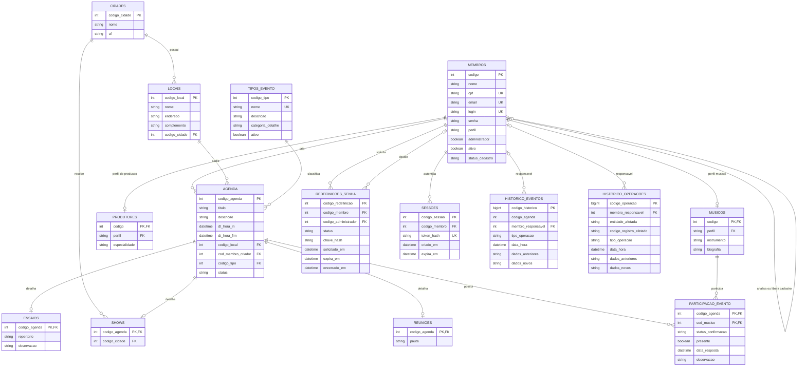

# Agenda da Banda

Aplicação web para organizar os compromissos de uma banda, reunir músicos em ensaios, shows e reuniões e acompanhar confirmações e presenças. O sistema centraliza a agenda, os locais dos eventos e a administração dos membros, com controle de acesso e persistência em SQL Server.

Desenvolvido como Mínimo Produto Viável (MPV) para o Projeto de Extensão Comunitária do 4º semestre.

**Repositório:** [Sollo99/AgendaBandaV2](https://github.com/Sollo99/AgendaBandaV2)

## Sumário

- [Funcionalidades e perfis](#funcionalidades-e-perfis)
- [Tecnologias e requisitos](#tecnologias-e-requisitos)
- [Instalação e execução](#instalação-e-execução)
- [Acesso e uso](#acesso-e-uso)
- [Roteiro de avaliação](#roteiro-de-avaliação)
- [Regras de negócio](#regras-de-negócio)
- [Banco de dados e arquitetura](#banco-de-dados-e-arquitetura)
- [Configuração e segurança](#configuração-e-segurança)
- [API](#api)
- [Solução de problemas](#solução-de-problemas)
- [Equipe e licença](#equipe-e-licença)

## Funcionalidades e perfis

| Área | Recursos |
| --- | --- |
| Agenda | Calendário, criação de eventos, detalhes, edição, cancelamento e exclusão conforme as permissões. |
| Eventos | Ensaios com repertório e observação, shows com cidade e reuniões com pauta. |
| Participações | Seleção de músicos em qualquer categoria de evento, confirmação de participação e registro administrativo de presença ou ausência. |
| Cadastros | Membros, cidades, locais e tipos de evento, com validação dos dados e dos relacionamentos. |
| Contas | Cadastro sujeito à aprovação, edição do próprio perfil, ativação e desativação de membros e recuperação de senha mediada por administrador. |
| Relatórios | Resumo por tipo de evento, presença dos músicos, utilização de locais e consulta de históricos, com filtro de período. |
| Integridade | Prevenção de conflitos de horário, preservação das respostas ao editar eventos e proteção de registros vinculados. |

Cada conta possui um perfil operacional: **membro**, **músico** ou **produtor**. A permissão de **administrador** é independente desse perfil.

- **Membro autenticado:** consulta a agenda, administra o próprio perfil e cria eventos. Pode editar ou excluir os eventos que criou, respeitando as regras do sistema.
- **Músico:** também responde às próprias participações em ensaios, shows e reuniões.
- **Produtor:** possui cadastro de especialidade e utiliza os recursos comuns aos membros.
- **Administrador:** gerencia usuários e cadastros, analisa solicitações, administra eventos, registra presenças e acessa relatórios e históricos.

## Tecnologias e requisitos

| Componente | Tecnologia | Requisito para execução |
| --- | --- | --- |
| Backend | Java, Spring Boot, Spring Data JPA e JDBC | JDK 17 e Maven 3.9. |
| Frontend | React, TypeScript, Vite e Chakra UI | Node.js 22 ou superior e npm. |
| Banco de dados | Microsoft SQL Server | SQL Server 2016 SP1 ou superior; a edição Express pode ser utilizada. |
| Administração do banco | Scripts T-SQL | SQL Server Management Studio ou outro cliente compatível com separadores `GO`. |

O banco precisa de **nível de compatibilidade 130 ou superior**. Java, Maven, Node.js e npm devem estar disponíveis no terminal.

## Instalação e execução

### Obter o projeto

Clone o repositório e entre na pasta criada:

```powershell
git clone https://github.com/Sollo99/AgendaBandaV2.git AgendaBanda
cd AgendaBanda
```

Se o projeto já foi baixado, abra o terminal na pasta que contém `backend`, `database` e `web`.

### Preparar o SQL Server

1. Inicie a instância do SQL Server e conecte-se a ela pelo SQL Server Management Studio.
2. Para a conexão usada pela aplicação, habilite a autenticação do SQL Server junto à autenticação do Windows e o protocolo TCP/IP. Os valores padrão do projeto usam `localhost:1433`; se a instância utilizar outro endereço ou porta, ajuste a configuração do backend.
3. Conecte-se com uma conta que tenha permissão para criar o banco e o login da aplicação.
4. Execute os arquivos de [database](database) inteiros, uma única vez e na ordem abaixo.

| Ordem | Script | Finalidade |
| --- | --- | --- |
| 1 | [00_create_login.sql](database/00_create_login.sql) | Cria o banco `AgendaBanda`, o login `agenda_user` e suas permissões. |
| 2 | [01_create_schema.sql](database/01_create_schema.sql) | Cria tabelas, relacionamentos, restrições e índices. |
| 3 | [02_insert_data.sql](database/02_insert_data.sql) | Insere as contas e os dados de demonstração. |
| 4 | [03_functions.sql](database/03_functions.sql) | Cria as funções de presença, conflitos e resumo por período. |
| 5 | [04_views.sql](database/04_views.sql) | Cria as consultas de agenda, presenças e ocupação dos locais. |
| 6 | [05_procedures.sql](database/05_procedures.sql) | Cria as operações transacionais de eventos e participações. |
| 7 | [06_triggers.sql](database/06_triggers.sql) | Cria os registros automáticos de auditoria. |

**Use uma base dedicada ao projeto:** o script `01_create_schema.sql` recria os objetos e remove os dados anteriores. O backend utiliza a estrutura preparada pelos scripts; sua inicialização não cria as tabelas.

Ao alterar autenticação ou TCP/IP na configuração do SQL Server, reinicie o serviço da instância.

### Iniciar o backend

Em um terminal na raiz do projeto:

```powershell
cd backend
Copy-Item .env.example .env
```

Abra `backend/.env` e confira os dados da conexão. A configuração padrão corresponde ao login criado pelo primeiro script:

```dotenv
DB_HOST=localhost
DB_PORT=1433
DB_NAME=AgendaBanda
DB_USER=agenda_user
DB_PASSWORD=agenda123
SERVER_PORT=8080
CORS_ALLOWED_ORIGINS=http://localhost:5173
```

Para uma instância nomeada ou uma conexão personalizada, informe a URL JDBC completa em `DB_URL`:

```dotenv
DB_URL=jdbc:sqlserver://localhost;instanceName=SQLEXPRESS;databaseName=AgendaBanda;encrypt=true;trustServerCertificate=true
DB_USER=agenda_user
DB_PASSWORD=agenda123
```

Em seguida, dentro de `backend`:

```powershell
mvn spring-boot:run
```

Mantenha o terminal aberto. A API estará disponível em `http://localhost:8080/api`.

### Iniciar o frontend

Abra **outro terminal** na raiz do projeto:

```powershell
cd web
npm ci --include=optional
npm run dev
```

Acesse **[http://localhost:5173](http://localhost:5173)**.

O frontend encaminha as chamadas de `/api` para o backend em `localhost:8080`. A configuração de referência está em [web/vite.config.ts](web/vite.config.ts). Use os endereços e as portas indicados para manter a conexão e os cookies consistentes.

Para gerar os arquivos estáticos da interface:

```powershell
npm run build
```

A saída será gravada em `web/dist`. As dependências devem ser instaladas no sistema em que o projeto será executado, usando o `package-lock.json`; `node_modules` não faz parte dos fontes.

## Acesso e uso

Após executar os scripts de preparação, estas contas estão disponíveis:

| Login | Senha | Acesso |
| --- | --- | --- |
| `admin` | `admin` | Administração e perfil de músico. |
| `usuario` | `usuario` | Músico sem permissão administrativa. |
| `teste` | `teste` | Músico sem permissão administrativa. |

Essas são **credenciais da aplicação**. O login `agenda_user` é exclusivo da conexão com o banco.

Na tela inicial, entre com uma das contas. A navegação apresenta **Agenda** e **Meu perfil**; administradores também acessam **Usuários**, **Locais**, **Cidades**, **Tipos de evento**, **Relatórios** e as solicitações de recuperação de senha.

### Cadastro de uma conta

1. Selecione **Criar conta**.
2. Informe os dados pessoais, as credenciais e o instrumento.
3. Entre como administrador e analise o pedido na tela **Usuários**.
4. Após a aprovação, o membro poderá entrar com seu login e senha.

O cadastro público cria um músico sem permissão administrativa. Contas pendentes ou recusadas não acessam a agenda.

### Recuperação de senha

1. O membro seleciona **Esqueci minha senha** e informa o login ou e-mail.
2. O administrador recebe a solicitação e confirma a identidade do membro presencialmente ou por um contato previamente conhecido.
3. Ao aprovar, o sistema exibe um código uma única vez ao administrador, para entrega ao membro identificado.
4. O membro seleciona **Já tenho o código do administrador**, informa o código completo e define a nova senha.

O pedido pendente tem validade padrão de 24 horas. Depois da aprovação, o código vale por duas horas e pode ser usado uma única vez. O administrador pode cancelar pedidos abertos. O fluxo utiliza entrega manual do código, sem envio automático de e-mail.

## Roteiro de avaliação

1. **Acesse como administrador.** Conheça o calendário e abra os detalhes de um evento.
2. **Crie um compromisso.** Escolha uma data, um local, o tipo de evento e os músicos participantes. Preencha repertório, cidade ou pauta conforme a categoria.
3. **Confira a persistência.** Atualize a página e abra novamente o evento cadastrado.
4. **Acesse como músico.** Use uma das contas vinculadas ao evento e confirme ou recuse a participação antes de seu início.
5. **Edite o evento como administrador.** Altere o título ou outro campo e confira a preservação da resposta do músico mantido.
6. **Explore os cadastros.** Cadastre uma cidade e um local; consulte também a administração de usuários e tipos de evento.
7. **Consulte Relatórios.** Selecione o período desejado e observe o resumo dos eventos, as presenças, a utilização dos locais e o histórico das alterações feitas pela aplicação.

O registro de presença fica disponível ao administrador a partir do início de um evento não cancelado. Para avaliar essa função, selecione um compromisso que já tenha começado.

## Regras de negócio

### Eventos e participações

- Os horários da agenda seguem o fuso de São Paulo (`America/Sao_Paulo`).
- Eventos possuem os estados `AGENDADO`, `REALIZADO` e `CANCELADO`.
- O horário final deve ser posterior ao inicial. Um evento só pode ser marcado como realizado após o término.
- Eventos não cancelados reservam o local e os músicos vinculados. Sobreposições são rejeitadas; horários consecutivos são permitidos.
- Cada músico tem uma única participação por evento, independentemente de ser ensaio, show ou reunião.
- Ao editar um evento, participantes mantidos conservam confirmação, presença, observação e data de resposta. Novos participantes começam como `PENDENTE`.
- O músico pode responder somente pela própria participação, antes do início de um evento agendado.
- O administrador registra presença ou ausência após o início. Presença positiva exige confirmação.
- Eventos realizados não podem ser reabertos ou excluídos. Registros de presença ou ausência também impedem a exclusão do evento e a remoção do participante correspondente.
- Um evento com presença registrada não pode ser cancelado ou reagendado para o futuro.

### Membros e cadastros

- Cada membro possui um único perfil operacional; a permissão administrativa é concedida separadamente.
- A desativação de um membro preserva seus vínculos. O último administrador ativo não pode ser desativado nem perder sua permissão.
- Músicos inativos não ficam disponíveis para novas inclusões em eventos; suas participações existentes são preservadas.
- Locais vinculados a eventos não podem ser excluídos.
- Cidades são únicas pela combinação de nome e UF, sem distinção entre maiúsculas e minúsculas.
- CPF, e-mail, login, senhas e limites de tamanho são validados. Senhas novas exigem ao menos seis caracteres e no máximo 72 bytes em UTF-8.
- Um administrador pode liberar CPF, e-mail e login de um cadastro recusado para um novo pedido, preservando o registro da decisão.

## Banco de dados e arquitetura

```text
AgendaBanda/
├── backend/
│   ├── src/main/java/br/com/fatec/agendabanda/
│   │   ├── config/        Configuração da aplicação
│   │   ├── controller/    API REST
│   │   ├── dto/           Entradas e respostas da API
│   │   ├── model/         Entidades persistentes
│   │   ├── repository/    Acesso a dados por JPA e JDBC
│   │   ├── security/      Sessões e proteção das requisições
│   │   ├── service/       Regras e operações da aplicação
│   │   └── validation/    Validações dos dados de entrada
│   └── src/main/resources/
├── database/             Scripts SQL Server
├── web/                  Interface React
└── README.md
```

O frontend consome a API REST. No backend, os serviços coordenam as operações e as transações. Os cadastros usam Spring Data JPA; a agenda, as participações e os relatórios também utilizam JDBC para executar os objetos SQL. Os scripts estão em `database` e possuem cópias em `backend/src/main/resources/db/scripts`.

### Modelo de dados

| Entidades | Responsabilidade |
| --- | --- |
| `membros`, `musicos` e `produtores` | Identificação, acesso e perfil operacional. |
| `cidades` e `locais` | Cadastro dos municípios e dos espaços dos eventos. |
| `tipos_evento` e `agenda` | Classificação, período, situação, local e criador de cada evento. |
| `ensaios`, `shows` e `reunioes` | Detalhes específicos da categoria do evento. |
| `participacao_evento` | Vínculo único entre músico e evento, com confirmação e presença. |
| `redefinicoes_senha` e `sessoes` | Solicitações de recuperação e sessões autenticadas. |
| `historico_eventos` e `historico_operacoes` | Auditoria de eventos, participações e campos administrativos dos membros. |

A definição completa dos campos, índices e restrições está em [01_create_schema.sql](database/01_create_schema.sql). As entidades Java estão em [model](backend/src/main/java/br/com/fatec/agendabanda/model).

<details>
<summary>Diagrama de entidade-relacionamento</summary>

O diagrama apresenta os relacionamentos e os principais atributos persistidos.



Os perfis de músico e produtor são exclusivos, protegidos por chaves estrangeiras compostas com o perfil do membro. A chave composta da participação impede duplicação do mesmo músico no evento.

O código do evento em `historico_eventos` é mantido sem chave estrangeira para a agenda, preservando o histórico quando um evento elegível é excluído. Os responsáveis pelos históricos são opcionais.

</details>

### Recursos SQL utilizados pela aplicação

| Recurso | Objeto | Uso |
| --- | --- | --- |
| Procedure | `usp_criar_evento` | Valida e grava o evento, os detalhes e os participantes em transação. |
| Procedure | `usp_atualizar_evento` | Atualiza o evento e sincroniza participantes preservando os registros mantidos. |
| Procedure | `usp_atualizar_participacao` | Aplica as permissões e as regras de confirmação e presença. |
| View | `vw_agenda_detalhada` | Reúne os dados e as contagens exibidos na agenda. |
| View | `vw_presenca_musicos` | Fornece os dados do relatório de participação e presença. |
| View | `vw_ocupacao_locais` | Relaciona locais, eventos e duração para o relatório de utilização. |
| Função escalar | `fn_taxa_presenca_musico` | Calcula o percentual entre presenças e ausências lançadas em eventos realizados. |
| Função com retorno de tabela inline | `fn_conflitos_agendamento` | Consulta eventos sobrepostos para validação de conflitos. |
| Função com variável-tabela | `fn_resumo_periodo` | Retorna os indicadores de eventos agrupados por tipo no período. |
| Trigger | `trg_agenda_historico` | Registra criação, alteração, reagendamento, cancelamento e exclusão de eventos. |
| Trigger | `trg_participacao_historico` | Registra operações nas participações sem copiar o texto livre da observação. |
| Trigger | `trg_membros_historico` | Registra alterações dos campos administrativos selecionados dos membros. |

`AgendaSqlRepository` chama as três procedures, consulta a view de agenda e usa a função de conflitos. `RelatorioSqlRepository` consulta as views de presença e ocupação e as funções de taxa e resumo. Os triggers são disparados pelas gravações realizadas pela aplicação.

As operações de agenda utilizam locks transacionais por evento, local e músico, com aquisição em ordem determinística. As procedures verificam os conflitos antes da gravação. A política de locks também é aplicada na exclusão de locais.

Nos relatórios, o período considera a data de início do evento. A taxa de presença fica sem valor quando não existem lançamentos elegíveis; eventos cancelados não compõem esse cálculo.

## Configuração e segurança

O arquivo [backend/.env.example](backend/.env.example) reúne as opções de conexão, acesso e retenção. As configurações mais relevantes são:

| Configuração | Uso |
| --- | --- |
| `DB_HOST`, `DB_PORT`, `DB_NAME`, `DB_USER` e `DB_PASSWORD` | Conexão com o SQL Server. |
| `DB_URL` | URL JDBC completa para configuração personalizada da conexão. |
| `SERVER_PORT` | Porta do backend; padrão `8080`. |
| `CORS_ALLOWED_ORIGINS` | Origens autorizadas a acessar a API; padrão `http://localhost:5173`. |
| `AUTH_COOKIE_SECURE` | Use `true` ao publicar em HTTPS; o valor `false` atende ao desenvolvimento local em HTTP. |
| `FORWARD_HEADERS_STRATEGY` e `PROXY_IPS_REGEX` | Configuração dos cabeçalhos encaminhados por um proxy confiável. |
| `AUTH_RECUPERACAO_PENDENTE_HORAS` e `AUTH_RECUPERACAO_APROVADA_HORAS` | Validade do pedido e do código de recuperação. |
| `AUDITORIA_EVENTOS_DIAS` e `AUDITORIA_OPERACOES_DIAS` | Retenção dos históricos; padrões de 365 e 180 dias. |

- Senhas são armazenadas como hash BCrypt. Tokens de sessão e códigos de recuperação também têm somente seus hashes persistidos.
- A sessão tem duração de oito horas e utiliza cookie `HttpOnly` com `SameSite=Strict`. Operações de escrita exigem token CSRF, preparado pelo frontend.
- O login tem limitação por IP e por falhas da combinação conta/IP. Cadastro e recuperação possuem limites próprios; excesso retorna HTTP 429.
- Alterar a senha encerra as sessões do membro e invalida autorizações de recuperação abertas.
- Relatórios e históricos exigem permissão administrativa. O histórico de membros omite CPF, e-mail, login e credenciais; campos livres de eventos podem conter informações inseridas pelos usuários.
- A limpeza dos históricos é feita em lotes, conforme os prazos configurados, sem arquivamento automático.

Em uma publicação, altere as credenciais de demonstração, utilize HTTPS e configure a origem real do frontend. Para acesso direto ao backend, mantenha `FORWARD_HEADERS_STRATEGY=NONE`. Se houver proxy reverso, configure `NATIVE` e restrinja `PROXY_IPS_REGEX` aos IPs confiáveis do proxy, que deve controlar os cabeçalhos encaminhados.

## API

A base local é `http://localhost:8080/api`. As rotas privadas exigem a sessão por cookie. Para chamadas de escrita fora da interface, obtenha o token em `GET /api/auth/csrf`, preserve os cookies e envie o valor em `X-CSRF-Token`.

| Área | Rotas principais |
| --- | --- |
| Autenticação | `GET /auth/csrf`; `POST /auth/login`; `POST /auth/logout`. |
| Cadastro e recuperação | `POST /auth/cadastro`; `POST /auth/recuperar-senha`; `POST /auth/redefinir-senha`. |
| Solicitações de senha | `GET /redefinicoes-senha/abertas`; `PATCH /redefinicoes-senha/{id}`; `POST /redefinicoes-senha/{id}/cancelar`. |
| Agenda | `GET/POST /agenda`; `GET/PUT/DELETE /agenda/{id}`. |
| Participações | `GET /agenda/{id}/participacoes`; `PATCH /agenda/{id}/participacoes/minha`; `PATCH /agenda/{id}/participacoes/{musicoId}`. |
| Perfil | `GET/PUT /membros/me`. |
| Membros | `GET/POST /membros`; `PUT /membros/{id}`; `PATCH /membros/{id}/status`. |
| Aprovação de cadastros | `PATCH /membros/{id}/cadastro`; `POST /membros/{id}/cadastro/liberar-identificadores`. |
| Seleção de músicos | `GET /membros/musicos`. |
| Cidades e locais | `GET/POST /cidades` e `/locais`; `PUT/DELETE /cidades/{id}` e `/locais/{id}`. |
| Tipos de evento | `GET/POST /tipos-evento`; `GET /tipos-evento/admin`; `PUT/DELETE /tipos-evento/{id}`. |
| Relatórios | `GET /relatorios?inicio=AAAA-MM-DD&fim=AAAA-MM-DD`; `GET /relatorios/historicos`. |

As permissões de cada operação são conferidas pelo backend; estar autenticado não concede acesso administrativo.

## Solução de problemas

| Situação | O que conferir |
| --- | --- |
| `mvn`, `java`, `node` ou `npm` não reconhecido | Instalação da ferramenta e configuração do `PATH`; reabra o terminal após instalar. |
| Falha de conexão com o banco | Serviço da instância, TCP/IP, porta, endereço e valores do `backend/.env`. |
| Login `agenda_user` recusado | Modo de autenticação do SQL Server, execução do script `00` na instância correta e senha configurada. |
| Tabela, função, view ou procedure inexistente | Execução completa dos sete scripts, na ordem indicada, e conexão ao banco `AgendaBanda`. |
| Pacote nativo do Rollup ausente | Execute `npm ci --include=optional` dentro de `web` no próprio sistema de destino. |
| Interface sem acesso à API | Backend em execução, porta `8080` e configuração do proxy em `web/vite.config.ts`. |
| Requisição recusada por origem ou CSRF | Acesso por `http://localhost:5173`, origem autorizada no backend e configuração de cookies compatível com HTTP local ou HTTPS publicado. |
| Porta já ocupada | Libere as portas `8080` e `5173` ou ajuste em conjunto o backend, o proxy e a origem autorizada. |

## Equipe e licença

**Equipe: System of a dev**

- Eduardo R. R. N.: qualidade e documentação.
- Lorena A. T.: gerenciamento do projeto.
- Paulo S. S.: desenvolvimento.
- Roberto B. F.: documentação e qualidade.

Licença GNU GPL v3. Consulte o arquivo [LICENSE](LICENSE).
