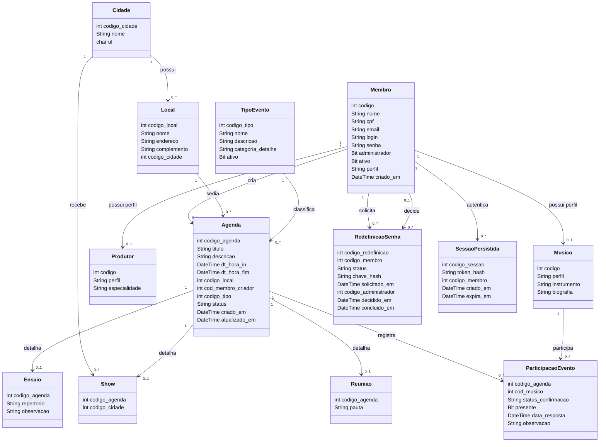

# Diagrama de classe

O membro possui um único perfil operacional: `MEMBRO`, `MUSICO` ou `PRODUTOR`. Os subtipos usam uma FK composta `(codigo, perfil)` para `membros`, com `perfil` fixo no respectivo subtipo. Isso impede que o mesmo código esteja nas duas tabelas de perfil. O indicador `administrador` é independente dessa classificação.

`ParticipacaoEvento` é o único vínculo de músicos com qualquer evento, incluindo ensaios. A chave composta impede duplicação do mesmo músico no mesmo evento. Um índice filtrado garante uma única solicitação de senha aberta (`PENDENTE` ou `APROVADA`) por membro.

Membros são desativados para preservar seus vínculos. Locais com qualquer evento vinculado não podem ser excluídos, mesmo se o evento estiver cancelado ou realizado.
