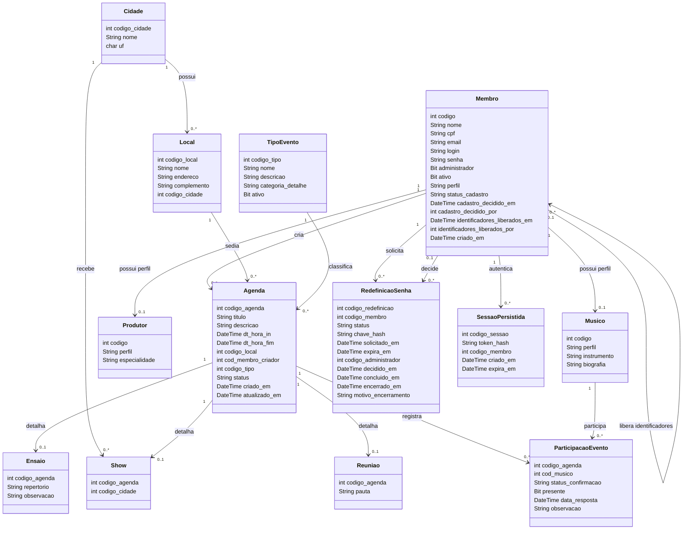

# Diagrama de classe

O membro possui um único perfil operacional: `MEMBRO`, `MUSICO` ou `PRODUTOR`. Os subtipos usam uma FK composta `(codigo, perfil)` para `membros`, com `perfil` fixo no respectivo subtipo. Isso impede que o mesmo código esteja nas duas tabelas de perfil. O indicador `administrador` é independente dessa classificação.

`ParticipacaoEvento` é o único vínculo de músicos com qualquer evento, incluindo ensaios. A chave composta impede duplicação do mesmo músico no mesmo evento. Um índice filtrado garante uma única solicitação de senha aberta (`PENDENTE` ou `APROVADA`) por membro.

Membros são desativados para preservar seus vínculos. Locais com qualquer evento vinculado não podem ser excluídos, mesmo se o evento estiver cancelado ou realizado.

`Cidade` tem restrição única por `(nome, uf)`, sem distinção de caixa. `TipoEvento.categoria_detalhe` aceita somente `EVENTO`, `ENSAIO`, `SHOW` e `REUNIAO`. A participação só admite presença positiva quando confirmada, protegida por CHECK. A validação do horário/status para registrar presença e marcar um evento como realizado pertence aos serviços Java.

O cadastro público começa `PENDENTE`, inativo e sem administração. Somente uma decisão administrativa o torna `APROVADO`; `RECUSADO` continua sem acesso. A restrição SQL impede conta não aprovada de ficar ativa ou administrativa. O responsável e a data da decisão são preservados em `membros`.

Depois da recusa, um administrador pode liberar conjuntamente CPF, e-mail e login: os três ficam nulos e a liberação registra responsável/data, preservando a recusa original. A restrição SQL permite campos nulos apenas nesse estado. Índices únicos filtrados ignoram os nulos e mantêm os identificadores reservados únicos. O registro liberado não volta a ser aprovado; é necessário um novo cadastro.

Uma recuperação fica aberta somente em `PENDENTE` ou `APROVADA`, sempre com `expira_em`. Encerramentos usam `CONCLUIDA`, `RECUSADA`, `EXPIRADA` ou `CANCELADA`, com data e motivo. O índice filtrado deixa de abranger o pedido encerrado e permite uma nova solicitação.
